<p align="center">
  
</p>

### Problem K. Koushik

<sub>time limit: real-time · memory limit: one cup of chai · input: microphone · output: earphones</sub>

You are given a stream of human speech. Build an agent that **listens, understands and whispers the right answer** before the speaker finishes the sentence.

I grind Codeforces at night and ship voice agents by day. Both have the same rule: *wrong answer on test 2 is still wrong.*

**Constraints**

```
1 ≤ latency ≤ 300 ms
hallucinations = 0
sleep ∈ O(1)
```

**Sample**

```diff
  input   → "our revenue grew 40% last quarter"
+ output  → (whisper) "it was 14%."
```

<p align="center">
  <a href="https://codeforces.com/profile/KVK18">codeforces</a> ·
  <a href="https://www.codechef.com/users/kvk18">codechef</a> ·
  <a href="https://www.linkedin.com/in/koushik-javvaji-110642264/">linkedin</a> ·
  <a href="https://koushikjavvaji.vercel.app">portfolio</a>
</p>
